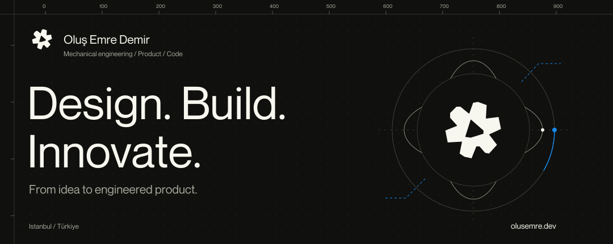
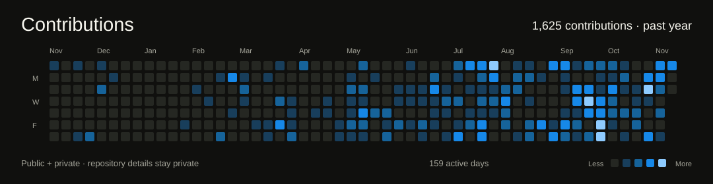

<a href="https://www.olusemre.dev">
  <picture>
    <source media="(max-width: 600px)" srcset="./assets/hero-mobile.svg">
    
  </picture>
</a>

[**Portfolio ↗**](https://www.olusemre.dev) &nbsp; · &nbsp; [LinkedIn](https://www.linkedin.com/in/olusemre/) &nbsp; · &nbsp; [Research journal](https://t0ttora.github.io/me492-caster-digital-twin/)

I’m **Oluş Emre Demir**, a mechanical engineering student at **Yeditepe University**, based in Istanbul. My work connects physical products, robotics and digital experiences.

## Selected work

### [Arche — Caster-aware digital twin](https://github.com/t0ttora/me492-caster-digital-twin)

A study of passive caster dynamics, mobile robot motion and simulation-to-reality agreement. Currently in research preparation.

[Research journal ↗](https://t0ttora.github.io/me492-caster-digital-twin/) &nbsp; · &nbsp; Mechanical modeling / Robotics

### [Acoustica — Room acoustics](https://github.com/t0ttora/acoustica)

A terminal-based engineering tool for reverberation, room modes and acoustic treatment planning.

Python / Textual / Acoustics

### [Noble Intel — Logistics intelligence](https://github.com/t0ttora/intel)

Maritime signal ingestion, retrieval-augmented intelligence and logistics risk analysis.

Python / Data systems / RAG

## Activity

<picture>
  <source media="(max-width: 600px)" srcset="./assets/contributions-mobile.svg">
  
</picture>

Public and private contributions, updated daily. Private repository names and activity details stay private.

---

[All public repositories](https://github.com/t0ttora?tab=repositories&amp;type=public) &nbsp; · &nbsp; [SHY BOI](https://github.com/t0ttora/shy_boi) &nbsp; · &nbsp; [NobleTracker](https://github.com/t0ttora/nobletracker)

Türkçe

Yeditepe Üniversitesi makine mühendisliği öğrencisiyim. Mekanik tasarım, robotik ve dijital ürünler üzerine çalışıyorum.

Seçilmiş çalışmalarımı yukarıda, daha geniş proje portfolyomu **[olusemre.dev](https://www.olusemre.dev/tr)** adresinde bulabilirsin. Aktivite takvimi açık ve özel depolardaki katkılarımı birlikte gösterir; özel depo adları ve çalışma ayrıntıları paylaşılmaz.

